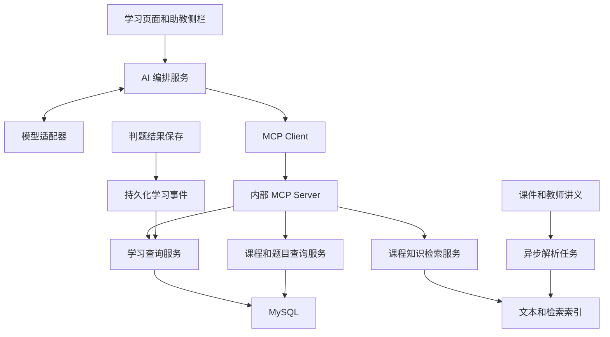
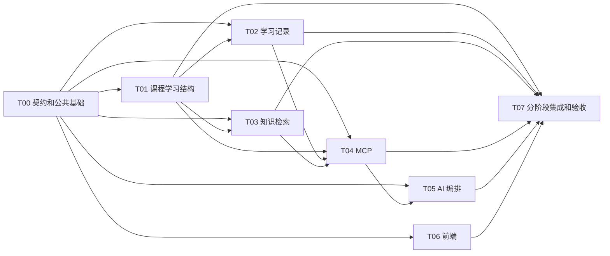

# AI 学习平台开发协作手册

本项目将现有课程与 Java 判题能力扩展为平台内置 AI 助教。助教服务当前登录学员，通过 MCP 查询本人学习记录，并引用课程资料进行概念答疑、做题提示和练习建议。开发采用单体后端、明确的模块边界和分阶段集成；不同 Agent 窗口通过仓库文件交接，不依赖聊天历史。

设计版本：0.1，冻结契约版本：0.1.1。基线日期：2026 年 10 月 7 日。本文描述目标设计；功能完成情况以任务索引和各任务文件中的代码、测试证据为准。当前已完成 T00 核心、T01 服务和 T02 基础服务；按用户要求暂停后续开发。

## 新窗口开始开发

1. 阅读本文，随后阅读 [任务索引](TASKS.md) 和目标任务文件。
2. 检查当前源码、已有变更和适用的 AGENTS.md，确认文档与工作区一致。
3. 按“窗口协作规则”认领任务；只编辑任务允许的文件。
4. 先完成上游契约，再实现代码。依赖未完成时，可以编写测试设计和显式 Mock，不能声称真实集成完成。
5. 每次结束窗口前，更新本人任务文件，并按 [交接模板](HANDOFF_TEMPLATE.md) 写明结果、验证、限制和下一步。

当前工作区为 `/Users/myfmac/Documents/Oj`，没有 Git 仓库。共享目录中的修改立即对其他窗口可见；当前采用目录认领和文件归属规则。若后续初始化 Git，可以使用独立分支或 worktree，但仍须保持契约和任务交接。

## 当前代码与目标边界

| 现有能力 | 代码入口 | 扩展方向 |
|---|---|---|
| Session 用户登录 | `src/main/java/com/example/oj/service/impl/UserServiceImpl.java` | 登录身份转换为不可变学员上下文 |
| 课程和资源管理 | `src/main/java/com/example/oj/service/impl/CourseServiceImpl.java`、`CourseResourceServiceImpl.java` | 课时、课程加入、读取权限、知识来源 |
| 题库和测试用例 | `src/main/java/com/example/oj/service/impl/ProblemServiceImpl.java` | 题目与知识点关联 |
| 同步提交和判题 | `src/main/java/com/example/oj/service/impl/SubmissionServiceImpl.java`、`JudgeServiceImpl.java` | 来源课时、判题事件、本人提交查询 |
| 本机 Java 沙箱 | `src/main/java/com/example/oj/sandbox/JavaNativeCodeSandbox.java` | 开发环境保留；真实上线前完成执行隔离 |
| React 页面和请求层 | `frontend/src/App.tsx`、`frontend/src/api/request.ts` | 学习页面、助教侧栏、流式请求 |
| MySQL 初始化 SQL | `src/main/resources/sql/oj.sql`、`course.sql` | 独立增量迁移，保留现有数据 |

原有入口尚未接入新模块：旧提交详情目前仅校验登录；旧课程状态不限制读取；`/uploads/**` 仍是静态文件映射；Vite 只代理 `/api`。新增 learning 模块已实现课程加入、课时、学习事件和严格本人提交查询；课程知识索引、AI 会话和六个业务 MCP 工具未实施。这些旧入口边界由集成任务统一调整，业务 Agent 不各自重写现有入口。

第一版覆盖课程加入、课时学习记录、题目知识点、本人做题摘要、PDF 与 PPTX 文本及教师讲义检索、六个只读 MCP 工具、带引用的助教对话。章节分组、视频转写、OCR、复杂掌握度评分、自动学习计划写入、外部 AI 客户端、多 Agent 助教、异步判题和多语言判题后续再做。

## 架构和模块归属



新增代码按业务包隔离，现有包保持兼容。本文中的类名表示待实现契约，不表示已有文件。

| 目录或文件 | 写入任务 | 职责 |
|---|---|---|
| `docs/ai-learning/contracts/` | T00 | API、Java 接口、工具 Schema、样例和变更记录 |
| `src/main/java/com/example/oj/platform/` | T00 | 身份、读取权限、契约 DTO 和接口 |
| `src/main/java/com/example/oj/learning/curriculum/` | T01 | 课程加入、课时、知识点关联 |
| `src/main/java/com/example/oj/learning/tracking/` | T02 | 事件、进度、统计和本人提交查询 |
| `src/main/java/com/example/oj/knowledge/` | T03 | 解析、版本、索引、检索和引用校验 |
| `src/main/java/com/example/oj/mcp/` | T04 | MCP Server、Client、认证和工具路由 |
| `src/main/java/com/example/oj/assistant/` | T05 | 会话、模型适配、编排、流式回答 |
| `frontend/src/features/learning/`、`features/assistant/` | T06 | 新页面、组件、API、类型和流式解析 |
| 现有 Java 文件、现有前端文件、构建与配置文件 | T07 | 旧模块连接、依赖安装、配置和回归 |
| `src/main/resources/sql/migrations/V00*.sql` | 对应任务 | 各模块增量结构；编号见数据约定 |
| `src/test/java/com/example/oj/{platform,learning,knowledge,mcp,assistant}/` | 对应模块任务 | 行为与权限测试 |

T00 和 T07 由同一个集成负责人窗口顺序执行。其他窗口需要修改共享文件时，在本人任务文件中写出路径、原因和预期修改，交由集成负责人执行；不长期保存必需集成步骤在聊天中。

## 身份和权限约定

REST 入口从现有 Session 得到用户，构造不可变 `StudentContext`，包含 `userId`、`role`、`requestId`。所有涉及个人数据的业务查询显式传入此上下文；异步任务复制必要身份与任务范围，不依赖可泄漏到其他请求的全局用户变量。

课程权限由 `CourseAccessService` 统一处理。

| 操作 | 规则 |
|---|---|
| 浏览课程简介和大纲 | 登录学员可读已发布课程；创建者和 admin 可读自己的管理范围 |
| 加入课程 | 当前登录学员自行加入已发布且未删除课程；重复加入返回已有记录 |
| 学习资源、知识检索、课程范围 AI | 已加入且课程已发布；创建者或 admin 可在管理范围预览 |
| 草稿或下线课程 | 普通学员不可读取资源、启动课程 AI 或检索；已有记录保留 |
| 编辑课时和关联知识点 | 课程创建者或 admin；题目本身仍由 admin 管理 |
| 学习摘要和提交源码 | 第一版仅本人可读；admin 不默认获得其他学员代码的 MCP 工具权限 |
| 会话、消息、流、引用资源 | 必须属于当前用户，并再次校验课程和资源权限 |

MCP 服务第一版仅供平台后端内部调用。Host 为每次请求提供短期签名凭据，绑定实际用户、受众、过期时间和只读 scope；Server 验证后建立自己的 `StudentContext`。共享 MCP Client 或连接不得保存唯一的“当前学生”。仅 Host 可以签发凭据，签名密钥不交给模型或浏览器。

前端会话 ID、工具参数中的课程 ID 和消息里的自称都不能充当身份证明。工具 Schema 不提供 `userId`，更不提供任意 SQL、文件路径或 URL。跨课程访问、任意提交 ID、伪造上下文均由服务端拒绝。

文件下载改走受控 `/api/learning/resources/{resourceId}/content`，校验权限并支持视频 Range 请求。课程封面可以公开；视频、课件和讲义不得通过旧 `/uploads/**` 地址绕过鉴权。旧资源 URL 需要迁移或转换；静态映射只保留明确允许公开的封面目录。

## 数据模型和迁移约定

T00 在开发前冻结具体 DDL、索引、DTO 和字段类型。以下为必须实现的语义。新接口 ID 统一使用十进制字符串，Java 使用 Long 并在契约边界转换，前端使用 string；现有数字 ID 接口保留兼容。新接口时间使用带时区 ISO 8601，持久化按 UTC 处理。

| 迁移及任务 | 数据结构 | 必须包含的语义 |
|---|---|---|
| V001 T01 | `course_enrollment` | user_id、course_id、status、joined_at；唯一 user_id 与 course_id，退出后重新启用同一行 |
| V001 T01 | `course_lesson` | course_id、title、objectives、sort_order、status；第一版不加章节 |
| V001 T01 | `lesson_resource`、`lesson_problem` | 课时关联既有资源和题目，排序；同一课时内不重复 |
| V001 T01 | `knowledge_point`、`lesson_knowledge_point`、`problem_knowledge_point` | 课程内稳定知识点 ID；课时和题目多对多关联 |
| V002 T02 | `learning_event` | event_id、user_id、course_id、lesson_id、type、source、occurred_at、payload、processing_status；event_id 全局唯一 |
| V002 T02 | `lesson_progress` | 用户课时唯一行、播放区间、最后位置、资源版本、完成状态、更新时间 |
| V002 T02 | `submission` 增量列 | 可空 course_id、lesson_id、assistance_level；题库独立提交仍合法 |
| V003 T03 | `knowledge_document` | 资源或讲义来源、course_id、lesson_id、version、content_hash、解析状态、active 标记 |
| V003 T03 | `knowledge_chunk` | document_id、version、文本、页码或时间位置、检索引用 ID；与索引保持关联 |
| V003 T03 | `knowledge_ingestion_job` | job_id、来源版本、状态、重试次数、错误、租约时间；可重试且幂等 |
| V004 T05 | `ai_conversation`、`ai_message` | 用户课程范围、消息幂等键、角色、状态、正文、引用、使用情况；同会话第一版仅允许一个生成任务 |
| V004 T05 | `ai_tool_call` | 会话消息、request_id、工具名、结果状态、耗时；参数和结果做脱敏与截断 |

关联表去重不得只依赖 Java 查询后插入。采用唯一键和明确的启用状态；解除关联后重新启用同一行，避免与逻辑删除唯一键冲突。个人历史和学习事件不级联物理删除。课程、课时、资源或题目删除后，历史数据保留，读取和检索遵循当前权限及有效状态。

新 SQL 放在独立 migrations 目录，禁止修改并重跑带 `DROP DATABASE` 的旧初始化脚本来升级数据库。每个迁移提供备份要求、一次性执行方式和重复执行行为；既有环境先检测表和列，再迁移。干净数据库的初始化与已有数据升级分别验证。

## 学习记录和统计约定

区分事件事实、统计结果和学习建议。第一版不输出百分比掌握度，不把观看完成或一次 ACCEPTED 解释为已经掌握。摘要必须返回统计范围、更新时间和证据 ID。

| 事件 | 产生方 | 语义 |
|---|---|---|
| LESSON_OPENED | 经认证的前端 | 访问课时；不代表完成 |
| RESOURCE_PROGRESS | 经认证的前端 | 上报实际播放区间及资源版本；属客户端行为证据 |
| LESSON_MARKED_COMPLETE | 经认证的前端 | 学员主动标记完成，显示为自报完成 |
| SUBMISSION_JUDGED | 后端 | 正式终态、提交 ID、题目、课程来源；客户端不得提交此类型 |
| AI_HINT_USED | AI 后端 | 已展示的提示等级和消息 ID；不等同于答案正确 |

资源进度合并区间并去重，不能通过多次上报增加观看时长；跳到结尾不能覆盖中间区间。第一版连续观看不严格防作弊，页面与摘要称为“记录进度”。资源版本变化后保留旧证据，新版本单独统计。

判题终态和 SUBMISSION_JUDGED 事件应在同一本地事务中持久化，事件 ID 按 `submission:{id}:judged:{revision}` 生成。事务在沙箱执行之后开启，不能跨整个编译运行过程持有数据库事务。所有终态路径包括提交服务兜底的 SYSTEM_ERROR，都通过统一结果保存入口。事件消费者采用租约和幂等更新，进程退出后可重试。

统计正式通过率时排除 PENDING、JUDGING 和 SYSTEM_ERROR，并返回分子、分母及各错误类型数量；零分母返回 null。课程题目可以共享，但按提交时保存的课程来源归属。assistance_level 可取 NONE、HINT、SOLUTION、UNKNOWN，只描述已观察到的辅助情况，不能证明没有使用外部帮助。

练习候选的“已通过”口径已由用户确认：统计本人所有课程和独立题库中的 ACCEPTED 记录。此标记与仅按保存的课程来源统计的课程摘要不同。

`LearningQueryService` 返回本人课程进度、近期错误分布和练习证据。薄弱点建议使用“建议复习”并附样本量、时间范围和证据；编译错误不自动解释为算法知识薄弱。

## 知识解析和检索约定

第一版支持教师 UTF-8 讲义、可提取文字的 PDF 和 PPTX。旧 PPT、扫描 PDF 和无字幕视频保留为学习资源，明确标记不支持 AI 检索。解析失败不阻塞文件上传，但不显示为 READY。

解析任务状态为 QUEUED、PROCESSING、READY、FAILED、UNSUPPORTED。按来源版本和内容 hash 去重，使用持久化任务与有限重试，不要求引入 MQ。解析必须使用平台保存的资源 ID 定位文件，不接受模型传入路径或远程 URL。

流程：提取文本 → 按标题和段落分段 → 保存原文位置 → 建立索引 → 原子切换有效版本。替换过程中可以继续提供旧的完整有效版本；新版本切换后，旧版本退出检索。删除或禁用来源立即阻断查询，物理清理可异步完成。并发任务只允许当前目标版本激活，避免旧任务晚完成覆盖新资料。

检索使用 `KnowledgeSearchService` 抽象。T03 可以先用显式标注的关键词检索基线，再接向量实现；具体解析库、Embedding 和索引依赖由 T00 与 T03 核对兼容性后记录。没有配置 Embedding 时，不得把关键词基线宣称为语义检索。

必须先按当前用户可访问课程、课时、来源有效版本限制候选，再检索和排序。权限变化后再次检查返回结果。MVP 的候选数量上限、单片段长度和总上下文长度均可配置；默认最多返回 5 个片段。

引用结构固定包含 `citationId`、`courseId`、`lessonId`、`resourceId` 或 `documentId`、`documentVersion`、`chunkId`、`title`、`pageNumber` 或 `timeStartSeconds/timeEndSeconds`、`excerpt`。引用 ID 由服务端生成；最终输出只接受本轮实际检索且仍可访问的引用，模型编造的 ID 不展示。

## REST 和服务契约

JSON REST 沿用 `BaseResponse` 和 `IPage` 风格，HTTP 状态、业务错误码和错误映射由 T00 明确。跨用户私有资源统一返回不可见或不存在，减少 ID 枚举泄漏。接口中的路径 ID 均为字符串语义。

| 方法与路径 | 入参要点 | 出参和行为 | 实现任务 |
|---|---|---|---|
| POST `/api/learning/enrollments` | courseId | 加入课程，重复请求幂等 | T01 |
| GET `/api/learning/courses/{courseId}/outline` | 无 | 可见课程大纲和学习目标 | T01 |
| GET `/api/learning/courses/{courseId}/lessons` | 分页 | 课时结构；本人进度从 summary 获取 | T01 |
| POST `/api/learning/courses/{courseId}/lessons` | 标题、目标、顺序 | 创建课时；修改和关联接口由 T00 冻结 | T01 |
| POST `/api/learning/events` | eventId、课时、事件类型、payload | 接收允许的客户端事件；不接受后端事件类型 | T02 |
| GET `/api/learning/courses/{courseId}/summary` | 时间范围 | 本人摘要，含 asOf 和证据 | T02 |
| GET `/api/learning/resources/{resourceId}/content` | Range 可选 | 鉴权后的文件内容，属于二进制响应 | T07 |
| POST `/api/knowledge/jobs` | resourceId 或受控讲义 ID | 管理者创建解析任务 | T03 |
| GET `/api/knowledge/jobs/{jobId}` | 无 | 解析状态，不暴露磁盘路径 | T03 |
| POST `/api/assistant/conversations` | courseId、lessonId 可选 | 创建本人会话 | T05 |
| GET `/api/assistant/conversations/{id}/messages` | 分页 | 本人历史与消息状态 | T05 |
| POST `/api/assistant/conversations/{id}/messages` | clientMessageId、content、mode、problemId/submissionId 可选 | POST 流式生成，重试幂等 | T05 |
| POST `/api/assistant/messages/{id}/cancel` | 无 | 取消本人生成任务，保留部分输出 | T05 |

课程、知识点、资源和题目关联管理的完整 CRUD 在 T00 的 OpenAPI 中冻结后再开发。当前已知路径是最小入口列表，不替代完整契约。

核心 Java 服务契约分别为 `CourseAccessService`、`CurriculumQueryService`、`LearningQueryService`、`SubmissionQueryService`、`KnowledgeSearchService`、`CitationValidationService`、`TutorToolGateway`、`TutorModelClient`。只依赖接口和契约 DTO；MCP 工具不直接查询 Mapper；AI 编排不通过绕过 MCP 的 Mapper 获取学员数据。T00 维护平台契约，其他任务提供实现。

## MCP 工具契约

工具输入不接受用户 ID。业务结果作为结构化输出，HTTP REST 包装不直接当作 MCP 协议响应；业务异常转换为受控工具错误，认证错误在传输层处理。具体协议和 SDK 版本在 T00 冻结并记录兼容性验证，不手写伪 MCP 协议。

| 工具名 | 允许的输入 | 返回内容 |
|---|---|---|
| `get_course_outline` | courseId | 课程课时、目标和知识点 |
| `get_my_learning_summary` | courseId、from/to 可选 | 本人进度、错误分布、分子分母、证据、asOf |
| `list_my_submissions` | courseId、problemId 可选、pageSize ≤ 20、cursor | 本人提交摘要，不批量返回源码 |
| `get_my_submission_detail` | submissionId | 本人代码、公开题意和受控错误摘要 |
| `search_course_knowledge` | courseId、lessonId 可选、query、topK ≤ 5 | 可访问片段及服务端引用 ID |
| `list_practice_candidates` | courseId、knowledgePointIds 可选、difficulty 可选、limit ≤ 10 | 真实题目、关联知识点、完成情况 |

六个工具只读。题目隐藏测试、标准答案、其他学员代码、密码、Session、文件路径和密钥均不返回。运行错误日志需要截断和脱敏。每个输出 Schema 定义空结果、字段单位、可空字段和业务错误样例。

T04 实现真实 MCP Server 和 Client，以及 `TutorToolGateway` 的生产实现。T05 可先使用同接口 Mock；Mock 和实际 MCP 通路在配置、页面状态和测试报告中区分。正式验收必须经过真实 MCP Client → Server → 业务服务。

## AI 答疑和流式协议

服务端验证会话与课程 → 组装当前课时与用户提问 → 模型选择工具 → Host 校验调用并经 MCP 执行 → 模型读取结果 → 验证引用 → 保存回答与状态。

mode 固定为 CONCEPT、HINT、REVIEW。CONCEPT 引用课程定义和例子；HINT 先解释和逐步提示，学员主动请求后才能给完整解法；REVIEW 分析本人提交与实际判题结果。AI 建议与正式判题状态分开保存，模型不能修改判题结果或学员成绩。

课程资料和学生代码都是数据，不作为系统指令。资料不足时注明一般性解释，工具失败时明确本次没有获取到相应记录。推荐题目必须来自工具返回的候选 ID，服务端再次校验可见性。

模型密钥仅保存在服务端环境变量中。通过 `TutorModelClient` 隔离供应商；T00 确定一家支持流式输出与工具调用的模型及适配库，具体选择写入决策记录。默认关闭未配置的真实模型功能，Mock 仅用于开发，不能静默替代真实回答。

前端用带 Cookie 的 fetch POST 读取 SSE，不能让现有 JSON Axios 拦截器解析流；校验同源或 CSRF token。以下为平台答疑流，与 MCP 传输独立。

| SSE event | data 字段 | 含义 |
|---|---|---|
| accepted | messageId、requestId | 消息已持久化并开始处理 |
| tool_status | toolName、status | 提示正在查询的业务能力，不展示私密参数 |
| delta | messageId、seq、text | 增量文本 |
| citations | messageId、items | 服务端验证后的引用 |
| completed | messageId、status、usage 可选 | 回答完成且已保存 |
| failed | messageId、code、message、retryable | 已建立流后的失败，部分回答保留 |
| cancelled | messageId | 取消完成 |

所有事件均含递增 seq；仅 JSON data，支持 UTF-8 分块和跨块拼接。响应为 text/event-stream，缓存关闭。生成状态为 QUEUED、RUNNING、COMPLETED、FAILED、CANCELLED、INTERRUPTED。进程启动时将无有效租约的 RUNNING 消息标记为 INTERRUPTED，不能永久显示生成中。

clientMessageId 在同一用户会话内唯一：重复提交返回已有消息状态，不重复调用模型。同一会话已有生成任务时拒绝第二个并发生成。浏览器断流可取消任务，服务端另有总超时兜底；刷新通过历史接口读取已保存内容，第一版不要求自动重放 SSE。建议初始总超时 60 秒、最多 6 次工具调用、单工具 10 秒，作为可调开发默认值，并非性能承诺。

## 任务顺序和集成节点



箭头代表真实验收依赖；契约冻结后，MCP、AI 和前端可以先基于契约 Mock 开发。T03 可以先解析夹具，T02 可以先处理模拟的服务端判题事件。接口未冻结时，仅 T00 允许发布公共契约。

| 节点 | 进入条件 | 退出证据 |
|---|---|---|
| M0 | T00 开始 | OpenAPI、服务接口、工具 Schema、流式事件、迁移字段和 SDK 决策冻结；契约样例验证 |
| M1 | T01、T02 可集成 | 真实加入与课时记录；真实判题产生持久化事件；两个用户互相隔离；旧题库路径回归 |
| M2 | T03、T04、T05、T06 可集成 | 一门课程资料经过真实索引，真实模型经 MCP 查询本人数据并回答，引用可打开 |
| M3 | T07 完成 | 权限变化、删除资料、失败恢复、并发会话和文件访问回归通过；配置与运行手册齐全 |

M2 的本机判题演示仅限可信开发环境。真实学员上线另设发布门槛：代码执行隔离、资源隔离和配额、进程树终止、输出上限、密钥管理与部署 HTTPS。当前 JavaNativeCodeSandbox 不满足该门槛，不能把文档中的 M3 等同于已经具备公网发布条件。

## 窗口协作规则

每个任务状态文件是该任务进度的唯一来源；[TASKS.md](TASKS.md) 只列依赖和入口，不由所有窗口同时修改。聊天说明不能代替状态文件。

认领时执行 `mkdir docs/ai-learning/claims/Txx`。成功后写入 `owner.md`，记录窗口标识、认领时间、工作区路径和任务，并更新对应任务文件。目录创建失败表示有人认领；不得覆盖或自行删除认领目录，应读取 owner 并由用户或集成负责人确认转交。目录存在不证明 Agent 仍在运行。

状态使用 TODO → CLAIMED → IN_PROGRESS → REVIEW → DONE；存在依赖或外部阻碍可记 BLOCKED。DONE 必须记录实际通过的验证，未运行的检查列为“未运行”并说明影响。移交只在责任明确后更新 owner；旧窗口停止写入。完成后保留认领记录作为交接证据。

T00 冻结契约后，所有变更先在本人任务记录中提出字段差异、影响任务和兼容方案，由集成负责人更新 contracts/CHANGELOG.md 并提高契约版本。依赖窗口读取新版本后更新本人的版本记录。不得通过修改多个窗口各自的 DTO 来“临时修好”。

禁止重置、删除或覆盖其他窗口未归属的修改；不改其他任务状态；不批量格式化全仓库；不在依赖失败时把 Mock 结果标记为真实通过。不自行发送其他窗口消息或创建窗口，除非用户另行授权。

新窗口可复制以下启动说明，将 Txx 替换为目标任务：

```text
工作区：/Users/myfmac/Documents/Oj。
请阅读 docs/ai-learning/README.md、TASKS.md 和 tasks/Txx.md，核对当前源码及适用的 AGENTS.md。
按手册的目录规则认领 Txx，确认依赖契约版本，只实现允许的文件范围。
共享文件的修改需求写入本任务交接，交给集成负责人；不要覆盖其他窗口的修改。
完成后运行任务所需检查，更新本任务状态和交接：改动文件、真实验证、未验证项、阻碍、下一步。
这次授权仅开发该任务，不包含部署、向其他窗口发送消息或自动创建新的 Agent。
```

## 验收和验证

契约冻结后，各任务添加能验证实际行为的测试。使用两个用户、两个课程、公开样例与隐藏测试、资料替换版本等夹具，不在测试中依赖真实学员资料或模型密钥。

| 验证范围 | 必须覆盖 |
|---|---|
| 身份隔离 | REST、MCP、会话、引用文件和异步任务均不能跨学员读取；共享 Client 并发调用不串身份 |
| 课程权限 | 未加入、草稿、下线、删除后不可读取资料或检索；管理者预览规则成立 |
| 学习事件 | 重复、乱序、客户端伪造判题事件、消费者中断和重试；结果与事件事务一致 |
| 进度统计 | 重叠播放去重、拖动不算完整观看、零分母、独立题库提交、资源版本变化 |
| 知识检索 | 真实可访问来源、版本切换、删除立即不可见、无结果、解析失败与不支持类型 |
| 答疑流 | UTF-8 分块、错误事件、取消、重复消息、并发生成、断流与进程恢复 |
| 教学行为 | 提示模式默认不直接给完整答案；引用有效；工具失败不编造学情；推荐真实题目 |
| 旧业务回归 | Session、题库独立提交、课程管理、封面和受控资源访问 |

后端使用 `./mvnw test`；需要 MySQL 的集成测试使用隔离测试库。前端使用 `npm run typecheck`、`npm run build`，新增流解析测试的运行方式由 T06 提出并经 T07 接入。真实模型验收使用显式启用的最小测试课程，记录请求结果与脱敏证据；默认测试不得产生外部模型费用。

缺少依赖、数据库或配置时，记录准确失败和未验证项。不能只用编译成功或 Mock 通路证明真实 MCP、检索和模型集成通过。

## 决策记录和待确认事项

已确定：平台内置、当前学员、单体优先、六个只读工具、课程范围权限、资料出处、事实与推断分开、分阶段集成。第一版课时优先于章节，学习摘要优先于掌握度评分。

T00 开发时需形成决策记录：模型与 API 适配、兼容当前 Java 17 和 Spring Boot 3.3.5 的 MCP SDK 与协议版本、解析库版本、索引实现和部署方式。若兼容性要求升级现有平台，先写出影响和迁移方案，由集成负责人统一修改构建；费用账户或不可推断的产品限制由用户明确。

参考协议职责：[MCP 架构](https://modelcontextprotocol.io/docs/learn/architecture)、[MCP 工具规范](https://modelcontextprotocol.io/specification/latest/server/tools)、[MCP 认证规范](https://modelcontextprotocol.io/specification/latest/basic/authorization)。正式选择 SDK 时重新核对所选协议版本，不能把 latest 链接当作永久冻结版本。
